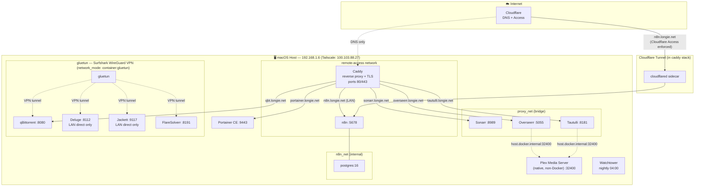

# Architecture

## Access summary

| Service | URL | Access path |
|---|---|---|
| n8n | `https://n8n.longie.net` | Internet — Cloudflare Tunnel + Access |
| Portainer | `https://portainer.longie.net` | LAN/Tailscale — Caddy reverse proxy |
| Sonarr | `https://sonarr.longie.net` | LAN/Tailscale — Caddy reverse proxy |
| qBittorrent | `https://qbt.longie.net` | LAN/Tailscale — Caddy reverse proxy |
| Tautulli | `https://tautulli.longie.net` | LAN/Tailscale — Caddy reverse proxy |
| Overseerr | `https://overseerr.longie.net` | LAN/Tailscale — Caddy reverse proxy |
| Jackett | `http://192.168.1.6:9117` | LAN direct — no Caddy |
| Deluge | `http://192.168.1.6:8112` | LAN direct — no Caddy |
